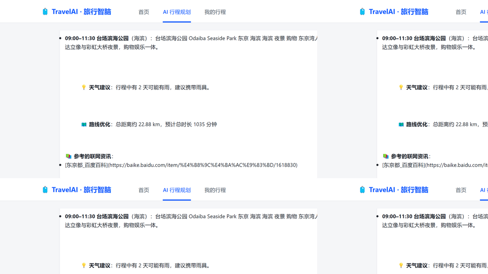
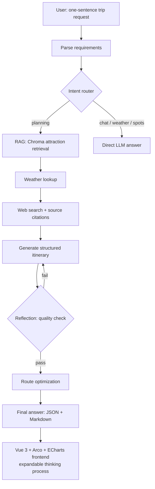

<div align="center">

# 🧳 TravelAI — AI Travel Planner

**Describe your trip in one sentence. A LangGraph agent researches, plans, self-reflects, and returns a complete multi-day itinerary — with every step of its thinking visible.**


[](https://github.com/xionghuazhou/ai-travel-planner/actions/workflows/ci.yml)
[](https://github.com/xionghuazhou/ai-travel-planner/releases)
[](CONTRIBUTING.md)

**English** | [简体中文](README.zh-CN.md)



*A real five-day Tokyo itinerary generated by the running system (rule-engine fallback mode).*

</div>

---

## 💡 What is this?

TravelAI is a full-stack AI travel planning system. Type something like *"Tokyo in early April, 5 days, 2 people, ¥20k budget, into culture"* and an **8-node LangGraph workflow** parses your intent, retrieves attractions from a vector knowledge base, checks weather, searches the web for up-to-date info, generates a structured itinerary, **reflects on its own output and regenerates if it fails quality checks**, then optimizes the route. You can expand every step of the agent's thinking in the UI.

If the LLM is unavailable, the system **degrades gracefully to a rule engine** that still produces a complete itinerary from the knowledge base — the demo never dead-ends.

## ✨ Features

- 🎯 **One-sentence trip planning** — structured multi-day itinerary (JSON + Markdown)
- 🧠 **Visible multi-step reasoning** — LangGraph workflow: intent parsing → routing → RAG retrieval → weather → web search → generation → **reflection & retry** → route optimization; every step expandable in the frontend
- 🌐 **Web search with citations** — the agent fetches current opening hours / tickets / reservation rules and cites sources in its answer
- 📚 **RAG knowledge base** — Chroma vector store seeded with **50+ attractions and 8 travel guides**
- 🛡️ **Anti-hallucination verification** — generated spots are cross-checked against retrieved sources before being accepted
- 💬 **Multi-intent chat** — planning, attraction queries, weather, small talk
- 🗺️ **Trip management** — save itineraries, spot-distribution chart (ECharts), daily timeline, print-to-PDF export
- 🔄 **Graceful degradation** — LLM down → rule-engine mode (frontend shows a badge); search failure never breaks the main flow
- 🔍 **Model auto-probing** — on startup the backend probes a candidate model list and uses the first available one

## 🏗️ Architecture



**Stack:** FastAPI + SQLAlchemy 2 (async) · LangGraph + LangChain · ChromaDB · PostgreSQL / SQLite · Redis · Vue 3 + TypeScript + Arco Design + ECharts · Docker Compose (5 services) + nginx.

## 🚀 Quick Start (Docker, recommended)

> Requires Docker Desktop and an API key for any **OpenAI-compatible** LLM endpoint (SiliconFlow, OpenAI, DeepSeek, local vLLM/Ollama, …).

```bash
# 1. Configure
cp .env.example .env          # Windows: copy .env.example .env
#    → fill in LLM_API_KEY

# 2. Launch all 5 services (backend / worker / postgres / redis / frontend)
docker compose up -d --build

# 3. Open
#    Frontend:  http://localhost:5173
#    API docs:  http://localhost:8000/docs
#    Health:    http://localhost:8000/health
```

First startup auto-creates tables and seeds the attraction knowledge base.

**Windows one-click**: double-click `启动助手.bat` (starts Docker → builds → waits for health → opens the browser). `停止助手.bat` stops services (data preserved); `查看日志.bat` tails logs.

### Local development (without Docker)

```bash
# Backend (Python 3.11+)
cd backend
python -m venv .venv && source .venv/bin/activate   # Windows: .venv\Scripts\activate
pip install -r requirements.txt
cp .env.example .env        # fill in LLM_API_KEY
python -m uvicorn app.main:app --host 0.0.0.0 --port 8000

# Frontend (Node 18+)
cd frontend
npm install
npm run dev                 # http://localhost:5173, proxies /api → :8000
```

## ⚙️ Configuration

| Key | Description | Default |
|---|---|---|
| `LLM_API_KEY` | OpenAI-compatible API key | — |
| `LLM_BASE_URL` | OpenAI-compatible endpoint | `https://api.siliconflow.cn/v1` |
| `LLM_MODEL` / `LLM_MODEL_CANDIDATES` | Preferred model + probe list | DeepSeek-V4-Flash |
| `EMBEDDING_PROVIDER` | `local` = zero-dependency hash embeddings (offline) · `openai` = semantic embeddings via API | `local` |
| `WEATHER_API_KEY` | Set to enable live weather; empty = simulated data | empty |
| `SEARCH_BACKEND` | `auto`: Bing CN → DuckDuckGo fallback | `auto` |
| `DATABASE_URL` | SQLite locally; PostgreSQL in Docker | SQLite |
| `SECRET_KEY` | JWT signing secret — **change it** | placeholder |

### 📌 Defaults & limitations (honest notes)

- **Weather** is simulated unless `WEATHER_API_KEY` is set.
- **Default embeddings** are lightweight local hash vectors (zero downloads, works offline). Set `EMBEDDING_PROVIDER=openai` for real semantic embeddings.
- The "map" is an **ECharts scatter distribution** of spots, not a tiled street map.
- **PDF export** uses the browser's print-to-PDF.

## 📁 Project Structure

```
├── backend/
│   ├── app/
│   │   ├── main.py            # Entry (auto schema + seed data)
│   │   ├── config.py          # Settings (LLM / DB / RAG)
│   │   ├── api/               # auth / agent / trips / spots routes
│   │   ├── agent/
│   │   │   ├── state.py       # AgentState
│   │   │   ├── nodes.py       # 8 workflow nodes (incl. reflection + spot verification)
│   │   │   ├── graph.py       # LangGraph StateGraph wiring
│   │   │   ├── memory.py      # Conversation memory
│   │   │   └── tools/         # spots / weather / route / web search
│   │   ├── rag/               # Chroma store + embeddings
│   │   ├── llm/               # OpenAI-compatible client + model probing
│   │   └── services/
│   ├── scripts/               # init_db / spots seed data / e2e test
│   └── Dockerfile
├── frontend/                  # Vue 3 + TS + Arco Design + ECharts
│   ├── src/{api,views,stores,router,types}
│   └── Dockerfile             # node build → nginx multi-stage
├── docker-compose.yml         # backend + worker + postgres + redis + frontend
└── .env.example
```

## 🛠️ Engineering Highlights

1. **Reflection loop** — the workflow grades its own itinerary and regenerates on failure, instead of shipping the first draft.
2. **Source-grounded spots** — generated attractions are verified against retrieved web/KB sources to suppress hallucinated places.
3. **Model candidate probing** — startup detects the first usable model from a list and caches it; `/health` reports LLM status and failure reasons.
4. **Full graceful degradation** — no usable LLM → rule-engine itineraries from the knowledge base, with a visible mode badge.
5. **Production-shaped deployment** — 5-service Docker Compose with healthchecks and `depends_on` conditions, nginx multi-stage frontend build, one-click Windows launchers.
6. **Type-aligned full stack** — TypeScript interfaces mirror backend Pydantic schemas end to end.

## 🧪 Tests

```bash
# Database configuration regression test (SQLite NullPool)
cd backend && python -m unittest discover -s tests -v

# With the backend running:
python backend/scripts/e2e_test.py   # health → register → spots → full planning → save trip
```

## 🗺️ Roadmap

- [ ] Keyless live weather (Open-Meteo) by default
- [ ] Semantic embeddings as the default provider
- [ ] Demo GIF / hosted live demo
- [ ] pytest unit tests for workflow nodes

## 🤝 Contributing

Issues and PRs are welcome! Please open an issue first for major changes.

## 📄 License

[MIT](LICENSE)

## 🙏 Acknowledgments

This project started as a reproduction of a public LLM-Agent development course project and was substantially reworked and extended by the author (see [Engineering Highlights](#-engineering-highlights)). Credit to the original course for the initial concept. Not affiliated with the course author.

<!--
After pushing to GitHub, uncomment to show star growth:

[](https://star-history.com/#xionghuazhou/ai-travel-planner&Date)
-->
