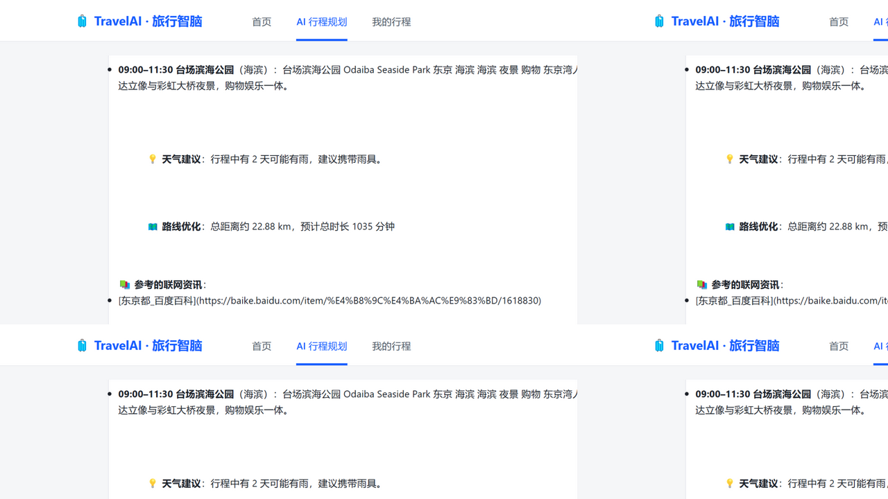
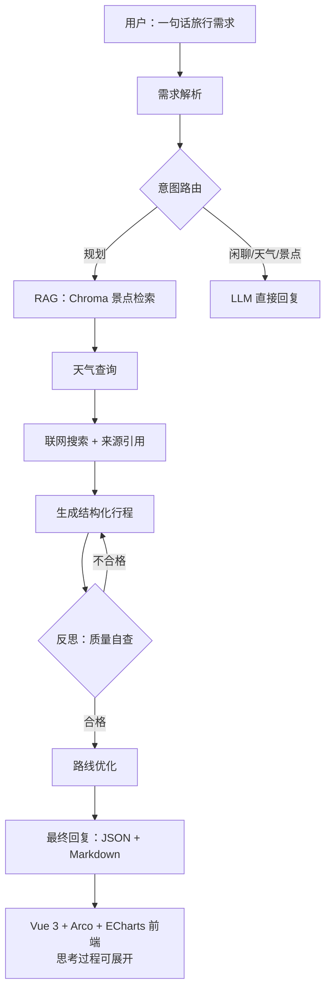

<div align="center">

# 🧳 TravelAI · 旅行智脑

**一句话描述旅行想法，LangGraph 智能体自动调研、规划、反思自查，生成完整多日行程——每一步思考过程可见。**


[](https://github.com/xionghuazhou/ai-travel-planner/actions/workflows/ci.yml)
[](https://github.com/xionghuazhou/ai-travel-planner/releases)
[](CONTRIBUTING.md)

[English](README.md) | **简体中文**



*本地实际运行生成的东京 5 天行程（规则引擎降级模式）。*

</div>

---

## 💡 这是什么？

TravelAI 是一个全栈 AI 旅行规划系统。输入例如 *"4 月初去东京，5 天 2 人，预算 2 万，喜欢文化"*，**8 节点 LangGraph 工作流**会解析意图、从向量知识库检索景点、查天气、联网搜索最新信息、生成结构化行程、**对自己的输出反思自查并在不合格时重新生成**，最后优化路线。前端可展开查看智能体每一步思考。

LLM 不可用时，系统**优雅降级为规则引擎**，仍基于知识库生成完整行程——演示永不冷场。

## ✨ 功能特性

- 🎯 **一句话行程规划** — 结构化多日行程（JSON + Markdown）
- 🧠 **多阶段思考可见** — LangGraph 工作流：需求解析 → 意图路由 → RAG 检索 → 天气 → 联网搜索 → 生成 → **反思重试** → 路线优化；每步可在前端展开
- 🌐 **联网搜索带引用** — 自动获取最新开放时间 / 票价 / 预约要求，并在回复中标注来源
- 📚 **RAG 知识库** — Chroma 向量库内置 **50+ 景点与 8 篇攻略**
- 🛡️ **防幻觉核验** — 生成的景点会与检索来源交叉核验后才被采纳
- 💬 **多意图对话** — 行程规划、景点查询、天气、闲聊
- 🗺️ **行程管理** — 保存行程、景点分布图（ECharts）、每日时间线、打印导出 PDF
- 🔄 **优雅降级** — LLM 不可用 → 规则引擎模式（前端显示标签）；搜索失败不影响主流程
- 🔍 **模型自动探测** — 启动时按候选列表探测第一个可用模型并缓存

## 🏗️ 架构



**技术栈：** FastAPI + SQLAlchemy 2（async）· LangGraph + LangChain · ChromaDB · PostgreSQL / SQLite · Redis · Vue 3 + TypeScript + Arco Design + ECharts · Docker Compose（5 服务）+ nginx。

## 🚀 快速开始（Docker，推荐）

> 需要 Docker Desktop 和任意 **OpenAI 兼容** LLM 接口的 API Key（硅基流动、OpenAI、DeepSeek、本地 vLLM/Ollama 等）。

```bash
# 1. 配置
cp .env.example .env          # Windows: copy .env.example .env
#    → 填入 LLM_API_KEY

# 2. 启动全部 5 个服务（backend / worker / postgres / redis / frontend）
docker compose up -d --build

# 3. 打开
#    前端页面:  http://localhost:5173
#    API 文档:  http://localhost:8000/docs
#    健康检查:  http://localhost:8000/health
```

首次启动自动建表并导入景点知识库。

**Windows 一键启动**：双击 `启动助手.bat`（启动 Docker → 构建 → 等待就绪 → 打开浏览器）；`停止助手.bat` 停止服务（数据保留）；`查看日志.bat` 实时看日志。

### 本地开发（不用 Docker）

```bash
# 后端（Python 3.11+）
cd backend
python -m venv .venv && source .venv/bin/activate   # Windows: .venv\Scripts\activate
pip install -r requirements.txt
cp .env.example .env        # 填入 LLM_API_KEY
python -m uvicorn app.main:app --host 0.0.0.0 --port 8000

# 前端（Node 18+）
cd frontend
npm install
npm run dev                 # http://localhost:5173，/api 代理到 :8000
```

## ⚙️ 配置说明

| 键 | 说明 | 默认 |
|---|---|---|
| `LLM_API_KEY` | OpenAI 兼容接口 API Key | — |
| `LLM_BASE_URL` | OpenAI 兼容接口地址 | `https://api.siliconflow.cn/v1` |
| `LLM_MODEL` / `LLM_MODEL_CANDIDATES` | 首选模型 + 探测列表 | DeepSeek-V4-Flash |
| `EMBEDDING_PROVIDER` | `local` = 零依赖哈希词嵌（离线可用）· `openai` = API 语义嵌入 | `local` |
| `WEATHER_API_KEY` | 填入后启用真实天气；留空 = 模拟数据 | 空 |
| `SEARCH_BACKEND` | `auto`：必应中国 → DuckDuckGo 自动降级 | `auto` |
| `DATABASE_URL` | 本地 SQLite；Docker 中 PostgreSQL | SQLite |
| `SECRET_KEY` | JWT 签名密钥——**务必修改** | 占位符 |

### 📌 默认行为与已知限制（如实说明）

- **天气**默认使用模拟数据，设置 `WEATHER_API_KEY` 后启用真实查询。
- **默认嵌入**为轻量本地哈希向量（零下载、离线可用）；设置 `EMBEDDING_PROVIDER=openai` 启用真正的语义嵌入。
- "地图"为 **ECharts 散点分布图**，非瓦片街道地图。
- **PDF 导出**使用浏览器打印为 PDF。

## 📁 项目结构

```
├── backend/
│   ├── app/
│   │   ├── main.py            # 入口（自动建表 + 种子数据）
│   │   ├── config.py          # 配置（LLM / 数据库 / RAG）
│   │   ├── api/               # auth / agent / trips / spots 路由
│   │   ├── agent/
│   │   │   ├── state.py       # AgentState 状态机
│   │   │   ├── nodes.py       # 8 个工作流节点（含反思 + 景点核验）
│   │   │   ├── graph.py       # LangGraph 图构建
│   │   │   ├── memory.py      # 对话记忆
│   │   │   └── tools/         # 景点 / 天气 / 路线 / 联网搜索
│   │   ├── rag/               # Chroma 向量库 + 嵌入
│   │   ├── llm/               # OpenAI 兼容客户端 + 模型探测
│   │   └── services/
│   ├── scripts/               # init_db / 景点种子数据 / e2e 测试
│   └── Dockerfile
├── frontend/                  # Vue 3 + TS + Arco Design + ECharts
│   ├── src/{api,views,stores,router,types}
│   └── Dockerfile             # node 构建 → nginx 多阶段
├── docker-compose.yml         # backend + worker + postgres + redis + frontend
└── .env.example
```

## 🛠️ 工程亮点

1. **反思闭环** — 工作流给自己的行程打分，不合格自动重新生成，而不是直接输出初稿。
2. **来源核验防幻觉** — 生成的景点与联网/知识库来源交叉核验，抑制编造景点。
3. **模型候选探测** — 启动时探测列表中第一个可用模型并缓存；`/health` 报告 LLM 状态与失败原因。
4. **全链路优雅降级** — 无可用 LLM → 知识库规则引擎行程，前端显示模式标签。
5. **生产形态部署** — 5 服务 Docker Compose（健康检查 + depends_on 条件）、nginx 多阶段前端构建、Windows 一键脚本。
6. **类型级全栈对齐** — 前端 TypeScript interface 与后端 Pydantic schema 端到端一致。

## 🧪 测试

```bash
# 数据库配置回归测试（SQLite NullPool）
cd backend && python -m unittest discover -s tests -v

# 后端启动后：
python backend/scripts/e2e_test.py   # 健康 → 注册 → 景点 → 完整规划 → 保存行程
```

## 🗺️ 路线图

- [ ] 默认启用免 Key 实时天气（Open-Meteo）
- [ ] 语义嵌入作为默认 provider
- [ ] 演示 GIF / 在线 Demo
- [ ] 工作流节点 pytest 单元测试

## 🤝 贡献

欢迎 Issue 和 PR！重大改动请先开 Issue 讨论。

## 📄 许可证

[MIT](LICENSE)

## 🙏 致谢

本项目最初复现自一个公开的 LLM-Agent 开发课程项目，随后由作者大幅重构与扩展（见[工程亮点](#-工程亮点)）。感谢原课程提供的初始概念。与课程作者无关联。

<!--
After pushing to GitHub, uncomment to show star growth:

[](https://star-history.com/#xionghuazhou/ai-travel-planner&Date)
-->
